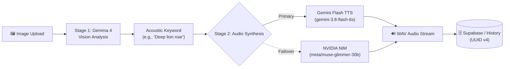

<div align="center">

# 🔊 Sona

### *Hear the Image. Voice the Visual.*

**Transform photos and visual concepts into high-fidelity soundscapes using Google Gemma 4 vision and Gemini Flash TTS, backed by NVIDIA NIM failover.**

[](https://fastapi.tiangolo.com)
[](https://ai.google.dev)
[](https://ai.google.dev)
[](https://build.nvidia.com)
[](https://supabase.com)
[](https://opensource.org/licenses/MIT)

[Features](#-features) • [Pipeline](#-pipeline-architecture) • [Quickstart](#-quickstart) • [API](#-api-endpoints) • [Configuration](#-environment-variables)

</div>

---

## 💡 Overview

**Sona** translates visual semantics into ambient audio design. Upload any image—a roaring lion, rolling thunder, or crashing surf—and Sona:
1. Extracts the primary acoustic signature with **Gemma 4 Vision**.
2. Synthesizes environmental sound via **Gemini Flash TTS** (or falls back to **NVIDIA NIM**).
3. Streams the resulting `.wav` soundscape and logs the interaction to **Supabase** with a persistent UUID.

---

## ✨ Features

- 🖼️ **Image-to-Soundscape**: Turns JPEG, PNG, or WebP inputs into playable `.wav` sound design.
- 🦁 **Gemma 4 Vision**: Extracts concise acoustic descriptors using `gemma-4-26b-a4b-it` (fallback: `gemma-4-31b-it`).
- 🎙️ **Resilient Audio Generation**:
  - **Primary**: Ultra-low-latency sound synthesis via Gemini Flash TTS (`gemini-3.8-flash-tts`).
  - **Fallback**: Acoustic descriptor enrichment via NVIDIA NIM (`meta/muse-glimmer-30b`).
- 🛡️ **Production Reliability**: Exponential backoff with jitter on 429/5xx codes, fast skip on 404, and upload deduplication across retries.
- 📜 **Latest Changes Feed**: Built-in activity feed tracking recent queries, generated sounds, and model provenance.
- 🗄️ **Supabase Sync**: Automatic UUID v4 persistence for every interaction.
- ☁️ **Cloud-Native**: Zero local GPU weights required; runs anywhere with Python 3.11+.

---

## 🧠 Pipeline Architecture



---

## 🚀 Quickstart

### 1. Clone & Install

```bash
git clone https://github.com/azid0azide/sona.git
cd sona

python3 -m venv .venv
source .venv/bin/activate  # Windows: .venv\Scripts\activate
pip install -r requirements.txt
```

### 2. Configure Environment

Create `.env` in the repository root:

```ini
# Google AI Studio (Required for Gemma 4 & Flash TTS)
# https://aistudio.google.com/apikey
GEMINI_API_KEY=your_gemini_api_key

# NVIDIA NIM (Optional: for Muse Glimmer failover)
# https://build.nvidia.com
MUSE_API_KEY=nvapi-your_nvidia_key

# Supabase (Optional: for cloud activity tracking)
# https://supabase.com
SUPABASE_URL=https://your-project.supabase.co
SUPABASE_KEY=your_supabase_key
```

### 3. Run the App

```bash
uvicorn app.main:app --reload --port 8000
```

Visit **[http://localhost:8000](http://localhost:8000)** to generate soundscapes or ask visual questions.

---

## 📡 API Endpoints

| Method | Endpoint | Description | Payload |
| :--- | :--- | :--- | :--- |
| `POST` | `/api/soundscape` | Generate WAV sound design from an image | Multipart `image` (JPEG/PNG/WebP) |
| `POST` | `/api/ask` | Ask Gemma questions about an image or prompt | Form `question`, optional `image` |
| `GET` | `/api/history` | Retrieve recent activity feed | Query param `limit` (default: 20) |
| `DELETE` | `/api/history` | Clear in-memory activity feed | None |
| `GET` | `/health` | Check service health status | None |

### CLI Usage

Execute the pipeline directly from your terminal:

```bash
python -m app.gemma lion.jpg lion_roar.wav
```

Output:
```text
Keyword   : Deep lion roar
Vision    : gemma-4-26b-a4b-it
Audio     : gemini-3.8-flash-tts
Attempts  : 2
Saved to  : lion_roar.wav (44,100 bytes)
```

---

## ⚙️ Environment Variables

| Variable | Description | Default |
| :--- | :--- | :--- |
| `GEMINI_API_KEY` | Google AI Studio API key | *Required* |
| `MUSE_API_KEY` | NVIDIA NIM API key for Muse Glimmer fallback | *Optional* |
| `SUPABASE_URL` | Supabase project URL | *Optional* |
| `SUPABASE_KEY` | Supabase publishable/service key | *Optional* |
| `SOUND_VISION_MODELS` | Gemma 4 vision model failover chain | `gemma-4-26b-a4b-it,gemma-4-31b-it` |
| `SOUND_AUDIO_MODELS` | Audio generation model chain | `gemini-3.8-flash-tts,meta/muse-glimmer-30b` |
| `SOUND_RETRIES_PER_MODEL`| Retries per model on transient failures | `2` |
| `SOUND_BASE_DELAY_S` | Base exponential backoff delay (seconds) | `1.0` |
| `SOUND_TIMEOUT_S` | Per-request timeout (seconds) | `30` |

---

## 🗃️ Supabase Schema

Run this in your **[Supabase SQL Editor](https://supabase.com/dashboard)** to enable persistent logging:

```sql
CREATE TABLE IF NOT EXISTS interactions (
    id UUID PRIMARY KEY DEFAULT gen_random_uuid(),
    created_at TIMESTAMPTZ DEFAULT NOW(),
    kind TEXT NOT NULL,
    prompt_or_query TEXT NOT NULL,
    result_summary TEXT NOT NULL,
    vision_model TEXT,
    audio_model TEXT,
    attempts INT DEFAULT 1,
    has_image BOOLEAN DEFAULT FALSE
);

ALTER TABLE interactions ENABLE ROW LEVEL SECURITY;
CREATE POLICY "Allow public inserts" ON interactions FOR INSERT WITH CHECK (true);
CREATE POLICY "Allow public reads" ON interactions FOR SELECT USING (true);
```

---

## 🧪 Testing

Run offline unit tests:

```bash
pytest tests/ -v
```

---

## 📄 License

Distributed under the **MIT License**. See [`LICENSE`](LICENSE) for details.
